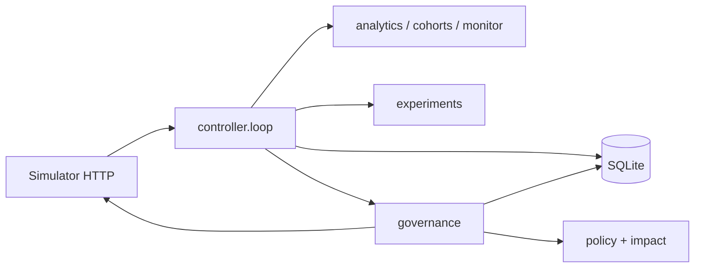

# Outcome-First Agent Loop — Submission

**Name:** SM Dileep · **Date:** 2026-11-10 · **Hours actually spent (be honest):** not tracked across the phased sessions · **Language / storage:** Python 3, one SQLite file per scenario (WAL)

---

## 0. TL;DR

The controller ingests simulator events over HTTP, keeps pickup, engagement, and business outcome separate, and designs experiments it does not execute. It submits a configuration change only when a fetched workflow policy allows that exact diff and the evidence is a confirmed live caller-id gap above the sample floors.

`reports/public_01.md` is the grade for a completed public_01 run: every workflow delta is 0.0%, and the controller applied 0 changes. `reports/public_02.md` is the grade for a completed public_02 run: 2 caller-id auto-applies on `ks_cancel`, 1 marked beneficial and 1 marked harmful. Governance changes made after that grade, including one-audit-per-supervisor-version, were not validated by a full rerun. `reports/public_03_load_measurements.md` is a partial load run: one simulated day took 34 min 29.8 s, so the 10-minute target was not met. A later query benchmark on a database copy is not a completed load test. Causal A/B testing is not implemented. A process-kill mid-run that was restarted to a correct finish was not demonstrated.

## 1. Assumptions

1. The workflow document from `GET /workflows` is the policy. Memo text that disagrees with it is not applied.
2. Approver hours bind `POST /approvals` only. Auto-apply is not delayed for those hours, because the simulator does not apply that window to `PUT /workflows/{id}/config`.
3. `mid_flight: next_campaign_only` locks cohorts, welcome, voice, and caller id. Prompt and schedule can still change immediately.
4. A total-variation shift equal to `max_shift` is allowed. A larger shift is an approval, not a silent expansion of the cap.
5. An observed caller-id gap is an association. It is not a predicted uplift and it is not a causal effect.
6. Historical call counts do not prove a unique-lead population, so they do not open an experiment and they do not by themselves justify a write.
7. Business outcome cannot be scored from call rows. Missing conclusions are not zeros.
8. Prompt-catalog wording is not evidence. A prompt change needs a validation run id, and pass rate is a safety check, not an engagement ranking.
9. One open proposal per workflow. A second change waits.
10. The grader's hidden scenarios use the same HTTP schema. Nothing below a scenario's hidden-truth marker is read into the controller.

## 2. Scope decisions

| # | Capability | Built / Partial / Cut | Why | What it would take to finish |
|---|---|---|---|---|
| C1 | Ingest | Built | HTTP chunks into SQLite, history and live kept apart, grouped totals updated in the same transaction. A full public_03 day still missed the time target. | A measured day after the snapshot change, on the target host |
| C2 | Shared cohorts | Built | One definition per workflow, one selecting pair, missing features excluded | — |
| C3 | History baseline | Built | History is before documented D0 | — |
| C4 | Per-person preferred hour | Cut | The API caps `lead_preferred_hour` at 200k and there is no evidence this beats cohort hours | A justified hour model and a policy-legal schedule proposal |
| C5 | Caller ID | Partial | Live, confirmed pickup gaps can move weight inside `max_shift`. public_02 did this twice. The grader marked the restore harmful on hidden DID health the controller cannot see. | A signal the API actually returns, not a hardcoded bad id |
| C6 | Welcome / voice experiments | Partial | Designs and a descriptive comparison exist. They are not applied and `causal` stays false | An API that exposes assignment and exposure independently of the caller |
| C7 | Decay rollback | Partial | A confirmed primary-KPI drop or guardrail breach can restore the previous config through the same policy. public_02's second caller-id apply is the graded example. It is not a separate decay model, and later governance edits were not re-run on that scenario. | A time-based decay test, still without reading hidden DID health |
| C8 | Hallucination response | Cut | No credit is spent ranking prompts, and summary keywords are not a selector | A validation run tied to a real engagement hypothesis, then an approval |
| C9 | Governance | Built | Policy, approval, auto-apply, verify, audit | — |
| C10 | Impact / dry run | Built | Observed gap only. Expected effect is null | A real counterfactual would need an experiment the API can enforce |
| C11 | Supervisor view | Partial | Snapshot JSON and the audit log, rebuilt on the hour, after a write, and when the loop stops. No separate screen | A read API over the same tables |
| C12 | Audit | Built | Append-only `audit_log` plus proposal and attempt rows. The current code records one supervisor-modification audit per config version. The graded public_02 database is not in this repository and was not rewritten. | — |
| C13 | Crash recovery | Partial | Lost advances, lost approvals, and a clean controller restart are tested. A kill of a live process mid-write, followed by a restart that finished the scenario, was not run. | One real kill/restart log on a scenario that then reaches `finished` |
| C14 | Metrics | Partial | Loop records ingest lag and credits on each tick | A paging sink. The log is the current surface |
| C15 | Credit reserve | Cut | Suggest-fixes and validation are not called from the live loop | A budget that spends credits only when a prompt decision would change |

The principle: do not write a configuration the fetched policy does not allow, and do not describe an observational comparison as a causal win. Thresholds were not lowered to produce a proposal or to avoid the harmful public_02 grade.

## 3. Stakeholders

### 01 Sales — Nikhil Rao

Accepted: caller-id and schedule changes may auto-apply where the signed policy says so, and a confirmed gap should not wait for a decorative approval.

Pushed back: there is no blended score. Kestrel has not enabled auto-apply for everything. Northwind KYC auto-apply is off in the workflow document. The persuasive prompt is not rolled out from a catalog adjective.

Wrong against the contract: "Kestrel has already turned on auto-apply for everything" and "Northwind [is] fine with auto-apply on the KYC flow." `ks_cancel` allows schedule, caller id, welcome, and voice, with max shift 0.20, not prompt or cohorts. `nw_kyc` has auto-apply disabled.

Reply: The summit number will be three rates, not one blend: pickup, engagement, and leads concluded over leads uploaded. KYC does not auto-apply; the workflow document has it off, so a KYC change waits for a named approval. Kestrel auto-apply covers schedule, caller id, welcome, and voice, and only inside a 0.20 shift. I will not ship the persuasive prompt because a catalog adjective is not an engagement result, and a script change needs validation plus approval.

### 02 Compliance — Meera Iyer

Accepted: welcome, voice, and prompt on Northwind go through approval. Prompt changes require a validation run id. Approver hours are read from the document (renewal 10:00–19:00, KYC 10:00–18:00). Operational caller-id and schedule changes use only the latitude that document grants. The audit row is the answer to what was live.

Pushed back: nothing. The conditions match the policy.

Wrong: nothing in the conditions contradicted the fetched `nw_renewal` / `nw_kyc` documents.

Reply: Customer-facing changes on Northwind — opening line, voice, and script — go to a named approval, and a script change includes the validation run id. Caller id and schedule use the auto-apply latitude already in the policy, and each of those writes is in the audit log with the proposal, the versions, and the evidence ids. Requests are held outside your approver hours instead of being queued overnight. We would rather make no change than make one we cannot explain.

### 03 Platform — Kabir Menon

Accepted: one SQLite file, no new service. Advance and governance writes are not retried blindly. A restart reads server state before another post.

Pushed back: the public_03 one-day-in-10-minutes number is not claimed as met. The measured day was slower than that.

Wrong: nothing he required contradicts the API. The load target is unmet, not false.

Reply: The process can be killed and restarted in design: the advance is reconciled from `sim_minute`, and an in-flight approval or auto-apply is reconciled from `GET /approvals` and config history before we post again. That reconciliation is unit-tested. I have not killed a live scenario process and shown the restarted run finish. State is one SQLite file, WAL, no Redis. One simulated day of public_03 took 34 min 29.8 s on the machine I used, so I am not claiming the 10-minute target. A later snapshot query on a database copy dropped from 125.413 s to 0.127 s. That is a query benchmark, not a new load test. What I would page on is a verification mismatch or a write whose outcome is still uncertain after a read. A statistical non-finding can wait until morning.

### 04 Ops — Anita Desai

Accepted: a supervisor edit is authoritative. The controller does not overwrite it and does not roll it back. One open proposal at a time.

Pushed back: the contract for `ks_cancel` is 4 requests per 24 hours and approver hours 10:00–19:00, not 2 requests and not before 11:00. The tighter rule is a preference. The controller follows the document. Welcome and voice are inside Kestrel auto-apply, so a customer-facing change there can apply without a human if the shift is within 0.20. That is the signed policy, and it is called out here because it is easy to miss.

Wrong: "two requests a day" and "never before 11:00" are not the simulator policy.

Reply: I will not undo a prompt or any other config you save. If you edit a workflow, the open proposal for that version is dropped and I re-read the config before considering anything else. The policy you signed allows four requests in 24 hours from 10:00, not two from 11:00, so that is the limit I enforce. I also need to flag that welcome and voice are inside Kestrel's auto-apply list, capped at a 0.20 shift. If you want those to require a person, the policy document has to change. A verbatim script that only passes a safety check will not be selected as a winner.

### 05 Product — Tara Kulkarni

Accepted: pickup, engagement, and business outcome stay separate. Cohorts are one stored definition. Proposals store the diff, the affected count, the dry run, and an impact score. An expired proposal is not posted again as if it were fresh. An experiment that never ran is not treated as evidence. A change stays on that workflow.

Pushed back: per-person call time is cut (C4). There is no supervisor screen in this phase. The impact score is the absolute observed gap clipped to [0, 1]. It is not a forecast, and a high score does not skip governance.

Wrong: nothing in the definitions. The wishlist that all of those items are P0 cannot all be P0.

Reply: Pickup, engagement, and business outcome are stored and shown separately. A cohort id means one definition, shared by detection and by any later experiment plan. The impact score on a proposal is the observed gap, not a promised lift, and it cannot approve itself. Per-person call hours are not in this build: the cap is 200k pins and I do not have evidence they beat a cohort schedule. An experiment plan that was never applied is marked non-executable and is not used as a result.

### 06 CTO — Aryamann

Accepted: explainable and small over a number nobody can sign. Credits are not spent on suggest-fixes in the live loop. Scope cuts are written down, including who was told no.

Pushed back: none of the strategy. The load envelope is still open: the measured public_03 day missed 10 minutes, and the later snapshot benchmark was not a full rerun.

Reply: I optimised for a change a compliance lead can reconstruct from the audit row. I said no to a blended score, to KYC auto-apply, to treating catalog text as a winner, and to per-person hour pins. The live loop spends no LLM credits. The scale result I can sign is the partial public_03 measurement: 34 min 29.8 s for one simulated day, target not met. I am not writing the copy-database query time in as a completed load test.

## 4. Architecture



Events land in SQLite. Call and lead group totals are updated in that same transaction. Each tick, before any new advance, reviews experiment designs without applying them, then calls `govern`. The supervisor snapshot is rebuilt on the first pass, after a configuration write, when the simulated hour changes, and when the loop stops. Governance reads the current config and the workflow document, stores the proposal, and only then calls the client. On restart the same database is opened. Rows in `submitting`, `uncertain`, `pending`, `approved`, `applying`, or `applied` are reconciled with the server before another write. A configuration the server already applied is verified from history instead of being applied again. `causal` on an experiment evaluation remains false.

## 5. The learning loop

Cohorts split at most one feature. The selecting pair must clear 800 dials for pickup or 400 connected calls for engagement, Bonferroni-adjusted alpha 0.05, and a 2 percentage-point gap. Other emitted levels are size-only and the reason text says they were not the selecting pair. Missing features are their own bucket, not members of the complement. The cap is 6 cohorts.

Experiment design uses a single alternative against the unique modal allocation. Several alternatives, or a tie, produce no design. The hash assignment is a plan. The live loop does not apply it. `executable`, `exposure_verified`, and `causal` stay false. A descriptive comparison can be stored after a valid one-call-per-lead ledger and the predeclared sample size. That comparison is still not causal. Business outcome returns inconclusive because the ledger has no verified lead conclusions. Repeated looks do not spend a second confirmatory test. Invalid ledgers do not consume the look.

There is no separate decay model. After an apply, governance compares the workflow's primary KPI and its guardrail on later calls. A winner is not promoted. Caller-id exploration is the bounded weight move described in `docs/GOVERNANCE.md`, and only after both the pickup and engagement floors are met on both options. A change that improves pickup while the destination is significantly worse on engagement is not sent.

## 6. Governance

States: `drafted`, `submitting`, `pending`, `approved`, `applying`, `applied`, `verified`, and the terminals `policy_rejected`, `rejected`, `expired`, `failed`, `lapsed`, `rolled_back`, plus `uncertain` when a read could not finish the story.

An outside-hours approval stays `drafted` until a later tick is inside the hours from the document. A 429 leaves the row drafted and waits for the next tick. A 409 stale base fails the row. A lost response is reconciled. If the approval exists, it is adopted and not posted again. If a successful read shows it does not exist, one later tick may post it. Expired and lapsed rows are not applied. The same proposal id is not rebuilt once it is terminal.

Auto-apply is used only for the decision `auto_apply_eligible`. The controller voluntarily does not auto-apply welcome or voice on Northwind, because those dimensions are not in that workflow's `allowed_dims`. It also does not auto-apply a caller-id move when the engagement comparison is unverified or negative.

After a write, verification compares caller id, welcome, and voice weights within `1e-6`, and compares schedule, prompt version, and cohorts exactly. History must contain the proposal id at the expected version. A mismatch is not reported as applied.

Post-change monitoring uses the workflow objective. Engagement is engaged/connected. Pickup is connected/dials. The guardrail uses that workflow's maximum drop. Business outcome is not scored from call rows. A confirmed primary drop or guardrail breach goes back through the same policy engine. A supervisor edit is left in place.

Impact score is `min(1, abs(observed_rate - baseline_rate))` when both rates and a positive sample exist. Otherwise it is 0 and the effect kind is `unverified`. Affected calls/dials is the dial count on the compared caller ids, an integer. The dry run records the observed difference and an explicit null expected effect. A supervisor edit sets the proposal to failed and writes `supervisor_modification_detected` once for that config version. The experiment module cancels a stored design on the same kind of edit. Neither path writes the old config back.

Production thresholds, unchanged: alpha 0.05, minimum absolute gap 0.02, pickup floor 800 dials, engagement floor 400 connected, business-outcome floor 400 leads, confidence 0.95, guardrail confidence 0.90 so a guardrail test uses alpha 0.10.

## 7. Incidents

Confirmed statistical findings are not incidents by themselves. The snapshot stores those as observations. Governance adds audit rows for a real write, a rejected policy, a verification failure, a supervisor edit, a confirmed post-change drop, and a rollback recommendation.

`reports/public_02.md` records three incidents: `did_flagged` on `ks_cancel` at D2 10:00, a supervisor edit on `ks_cancel` at D3 11:30 with `mttr_minutes` null and `fixed_by` null, and a supervisor edit on `nw_renewal` at D5 15:00. The controller did not overwrite those supervisor edits. Credits used were 0. Validation runs were 0. LLM fix calls were 0.

The public_02 run wrote `supervisor_modification_detected` 626 times for the same `ks_cancel` supervisor edit. That count is historical data from the run that produced the grade. `reports/public_02.md` was not rewritten to remove or explain those rows, and the database is not in this repository. The current code records that action once per supervisor config version (`controller/governance.py`, covered by `test_supervisor_modification_is_audited_once_per_version`). That dedup was not validated by replaying public_02.

`reports/public_01.md` has an empty incident list. The partial public_03 window had no supervisor edit.

## 8. Scale

`reports/public_03_load_measurements.md` is the load evidence. It is a partial run on a local Windows machine, not a reserved 4 vCPU / 8 GB host. The five-day scenario did not finish. `sim grade` was not run. An incomplete baseline was started and then stopped, and it must not be graded. That baseline is not in this repository.

| Item | Measured |
|---|---|
| One simulated day (minute 0 to 1,440) | 34 min 29.8 s. Target under 10 min. Not met. |
| Simulated time reached | Minute 1,680 of 7,200. `finished` false. |
| History ingest | 5,537,379 events in 5 min 25.3 s, about 17,000 events/s |
| Live events in that day | 840,012 |
| Events/s over the full simulated day | 406 |
| Events/s, 09:00–21:00 | 690 |
| Decision lag | About 0.8 s at night, 3.5–4 s in the day, 52–134 s on hourly snapshot ticks |
| Credits | 400 remaining of 400 |
| HTTP | 4,235 responses, all 2xx |
| Proposals / approvals / config changes | 0 / 0 / 0 |
| Controller peak memory | 1,686.8 MB |
| Checkpoint | Minute 1,680, event 6,377,391. A normal tick checkpoint, not a crash recovery. |

The hourly snapshot dominated the day. After that run, grouped totals were added so a snapshot reads those rows instead of scanning the raw aggregates. On a copy of the partial database, the snapshot-shaped query set went from 125.413 s to 0.127 s, and a second call was 0.151 s. The totals matched the source tables on that copy. No new simulated day was run afterward. A shorter day computed from those query times would be an estimate, not a load-test result. The only completed day measurement remains 34 min 29.8 s.

What still breaks first at 10× is the work that still scans `call_agg` on ordinary ticks, plus a single-threaded ingest of a much larger history. The 1,686.8 MB peak is the partial run's peak. Streaming the chunk body was added later and was not remeasured on a 5.5 million event ingest.

## 9. Reliability

Unit tests, not a killed production process:

- `tests/controller/test_loop.py` drops the advance response both before and after the minute moves and checks the restart does not double-count events. It also checks that governance runs on a `--max-advances 0` pass without calling advance.
- `tests/controller/test_governance.py` covers a lost approval that never landed, a lost approval that did land, a restart that leaves a pending approval unposted, a restart that verifies a configuration the server already applied, a 409 stale base, a 429, a duplicate id resolved by a read, an apply the server reports as lapsed, a supervisor edit between approval and apply, and a degradation that is invisible on a short sample and confirmed on a later tick.
- `tests/controller/test_rollup_durability.py` rolls back a failed aggregate flush, ignores a replayed chunk, and rebuilds grouped totals after an interrupted rebuild. Those are database transactions in a test process.
- `tests/controller/test_public_01.py` starts the separately supplied simulator, runs the controller for 40 advances, starts the controller again against the same state directory, and checks counts do not double. That is a clean process restart of a short prefix. It is not a kill during a write, and it is not the graded eight-day run.

The graded public_01 and public_02 runs were not killed and restarted. The public_03 controller was stopped on a time budget and was not restarted. I do not have crash-recovery evidence of the kind C13 asks for.

Writes use `idempotent=False` on the client. There is no idempotency key on advance or on the governance posts. The proposal id is the idempotency token the server actually enforces. A 4xx with a definite code fails or defers the row. A 5xx or a dropped connection stays `uncertain` until a read.

## 10. Audit & observability

Why a workflow changed:

```sql
SELECT id, ts, sim_ts, action, detail_json
FROM audit_log
WHERE workflow_id = 'ks_cancel'
  AND action IN (
    'proposal_created', 'approval_submitted', 'auto_apply_attempted',
    'configuration_applied', 'configuration_verification_failed',
    'degradation_detected', 'rollback_recommended', 'rollback_applied',
    'supervisor_modification_detected'
  )
ORDER BY id;
```

The proposal row holds `proposed_config_json`, `policy_json`, `evidence_json`, `impact_calculation_json`, `approval_id`, and `verification_json`. The simulator's public approval view does not echo `proposed_config`, so the local row is the copy that answers that question.

Page on `configuration_verification_failed`, `write_uncertain` that is still unresolved after a reconcile, and `supervisor_modification_detected` during an in-flight apply. Do not page on `policy_rejected`, an insufficient sample, or a confirmed observational finding that did not become a proposal. The historical 626-row repeat would have paged on every tick. The current code emits one row per supervisor version. That behavior is unit-tested and was not replayed against the graded public_02 log.

## 11. Results

### public_01

Completed and graded. Source: `reports/public_01.md`. Zero changes applied. Governance counters are all zero. Credits used: 0. Validation runs: 0. LLM fix calls: 0.

| workflow | conclusion rate | Δ | pickup | Δ | engagement | Δ | engagement gap captured | hallucinated calls (base) |
|---|---|---|---|---|---|---|---|---|
| ks_cancel | 0.333 | +0.0% | 0.238 | +0.0% | 0.491 | +0.0% | 0% | 47 (47) |
| nw_kyc | 0.364 | +0.0% | 0.242 | +0.0% | 0.591 | +0.0% | 0% | 21 (21) |
| nw_renewal | 0.420 | +0.0% | 0.263 | +0.0% | 0.546 | +0.0% | 0% | 42 (42) |
| ALL | 0.368 | +0.0% | 0.248 | +0.0% | 0.530 | +0.0% | 0% | 110 (110) |

`tests/controller/test_governance.py::test_public_01_policy_matches_the_simulator_and_a_legal_auto_apply_verifies` is a different run. It starts a simulator, fetches the three public_01 documents, and auto-applies one in-policy `ks_cancel` schedule change. After that call, config version was 2, actor `controller_auto`, and history recorded proposal `gov-public01-schedule`. `nw_kyc` was left at version 1. That test proves the client and the fetched policy agree. It is not the graded scenario, and the grade above applied nothing. The test needs the separately supplied simulator and `scenarios/public_01_dev.yaml`, which are not in this repository.

### public_02

Completed and graded. Source: `reports/public_02.md`. Latest governance fixes were not validated by a full rerun of this scenario.

| workflow | conclusion rate | Δ | pickup | Δ | engagement | Δ | engagement gap captured | hallucinated calls (base) |
|---|---|---|---|---|---|---|---|---|
| ks_cancel | 0.231 | -6.6% | 0.179 | -2.5% | 0.460 | -3.4% | 0% | 323 (330) |
| nw_kyc | 0.367 | -2.2% | 0.237 | -2.1% | 0.593 | +0.1% | 0% | 28 (31) |
| nw_renewal | 0.425 | -0.3% | 0.260 | -0.6% | 0.550 | +0.3% | 5% | 46 (55) |
| ALL | 0.325 | -2.9% | 0.218 | -1.7% | 0.525 | -0.9% | 3% | 397 (416) |

2 applied — beneficial: 1, harmful: 1.

- `ks_cancel` v2 (`controller_auto`) dims `caller_id`, engageΔ=+0.000, didΔ=+0.193 → beneficial
- `ks_cancel` v3 (`controller_auto`) dims `caller_id`, engageΔ=+0.000, didΔ=-0.159 → harmful

Governance: `auto_applied` 2, `approval_requests` 0, no rejections, no lapses, no apply conflicts. Credits used: 0. The harmful mark is the grader's DID-health delta. The controller does not receive that number and did not have its thresholds lowered to suppress the second apply.

### public_03

Not a finished load test and not graded. One simulated day took 34 min 29.8 s. The 10-minute target was not met. Details are in section 8. The 125.413 s → 0.127 s figure is a snapshot-query benchmark on a database copy. It is not a projected runtime and it is not a completed day.

### Tests

Recorded controller run, not executed again while writing this document: `python -m pytest -q tests/controller` — 116 passed, 1 warning, 119.78s. That is the suite after the grouped-total and streaming-ingest work. It includes the durability tests and the supervisor-audit-once test. It does not replace the scenario grades above.

## 12. Trade-offs & rejected alternatives

| Option | Why considered | Why rejected / what instead |
|---|---|---|
| Blended KPI | Sales wanted one number | Pickup, engagement, and business outcome answer different questions |
| Auto-apply every winning variant | Faster summit story | The policy lists the dimensions. Welcome and voice on Northwind are not on it |
| Rank prompts by summary text or pass rate | Easy to automate | Pass rate is safety. Catalog wording is not an engagement result |
| Treat the hash plan as exposure | Would let Phase 3 declare winners | The API samples each dial independently and does not return assignment |
| Use historical call counts as unique leads | Would open experiments sooner | The aggregate has no lead id. Population stays unverified |
| Hardcode public_01 max shift and hours | Avoids a fetch | Hidden scenarios share the schema and differ in the numbers |
| Retry a lost POST immediately | Simpler | The post may have landed. Read first |
| Per-person preferred hour | Product called it P0 | Cut. 200k cap and no evidence against cohort hours |
| Dashboard | Easier to demo | Not this phase |
| Lower the pickup floor so public_02 would not roll back | Would change the harmful grade | The guardrail fired on evidence the controller is allowed to see. Thresholds stayed put. |

## 13. Known weaknesses

- No causal experiment. A matching ledger is still not proof of randomization.
- The automatic proposal is only a caller-id weight move, and only after large live samples. Many real degradations will be detected in analytics and still not changed.
- The impact score is not a forecast. Ranking a queue by it ranks observed gaps, not expected value.
- Rollback uses the workflow primary KPI and its guardrail. Business outcome cannot trigger it, because call rows do not identify unique concluded leads. The public_02 harmful grade is hidden DID health, which this loop cannot see and did not encode.
- An expired proposal with the same version and the same diff is not rebuilt with fresh data. A new version produces a new id.
- The 626 duplicate supervisor audits are the earlier public_02 run. Current code deduplicates by version. That was not re-run against the scenario, and the grade report was not edited.
- public_03 did not finish five days and did not meet one day in 10 minutes. The snapshot-query improvement is a copy benchmark. Connection-health reads still scan `call_agg`. A rollup marker that is present will not repair corrupted totals. The 1,686.8 MB peak was not remeasured after streaming ingest.
- Crash recovery is tested with fakes, transaction rollback, and one clean restart of a short public_01 prefix. It was not demonstrated by killing a live controller and finishing the scenario.
- Suggest-fixes and validation are implemented on the client and are not called by the live loop.
- The supervisor surface is the database and the snapshot, not a screen.
- Anita's welcome/voice auto-apply on Kestrel is what the policy says. If the business did not mean that, the document is the thing to change. The controller will not pretend the list is shorter.
- `tests/controller/test_public_01.py` and the public_01 policy integration test need the separately supplied simulator and scenario file. They are kept, and they are not runnable from this tree alone.

## 14. If this went to production at Formi next month

1. Re-run public_02 and a full public_03 day on the target box after the current code, and write the new ingest rate, lag, and memory into `reports/`. Do not tune thresholds to survive them. Do not treat the 0.127 s query time as that result.
2. Add a paging check for `uncertain` writes older than one tick and for verification mismatches.
3. Put the audit query in the on-call note, with one worked example from a real apply, and say that a repeated supervisor audit from the old public_02 database is historical.
4. Confirm with Kestrel, in writing, that welcome and voice auto-apply within 0.20 is intended.
5. Only then consider a prompt change, and only with a validation run plus an approval, still without using the catalog text as the ranking.
